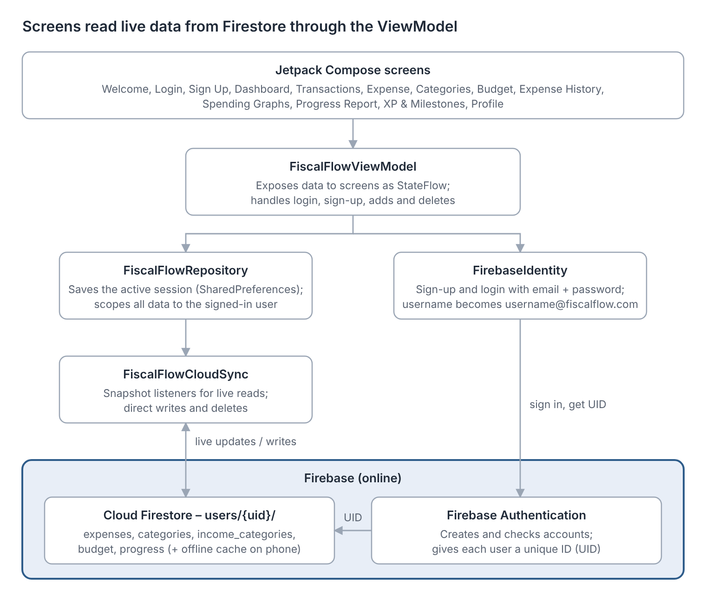
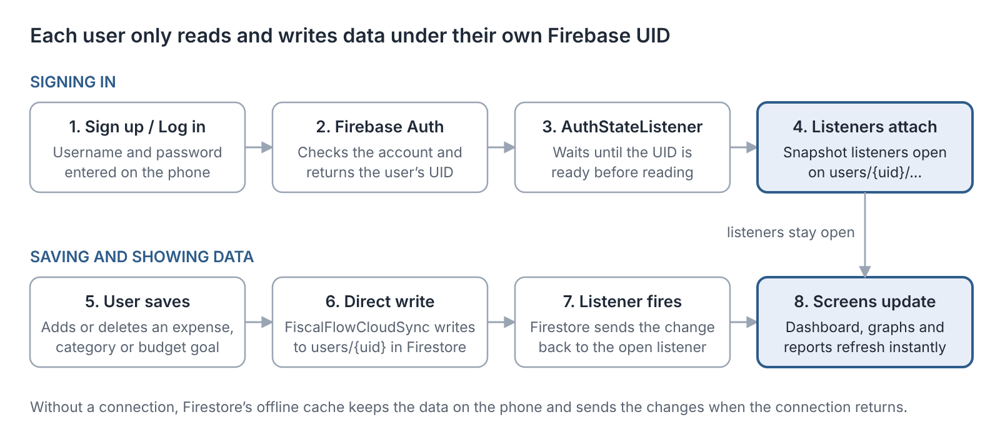

<p align="center"></p>

# FiscalFlow — Budget Tracker


FiscalFlow is an Android budgeting app for students and first-time budgeters in South Africa. Users log expenses and income in Rands against their own categories, set minimum and maximum monthly spending goals, and see clearly how they are tracking. Each user signs in with a Firebase account, and all of their data is stored online in **Firebase Cloud Firestore**, with Firestore's offline cache keeping the app usable without a connection.

> **Demo video (YouTube, unlisted):** link to be added
>
> **APK:** download `app-debug-apk` from the latest [GitHub Actions run](https://github.com/InsidiousVillian/FiscalFlow/actions), or build it with `./gradlew assembleDebug`.

**OPSC7311 — Part 3 (Final POE).** Team:

| Member | Student number |
| --- | --- |
| Harriet Manda | ST10252836 |
| Xiluva Maluleke | ST10438975 |
| Sechaba van der Merwe | ST10448656 |
| Jet Kingston | ST10441726 |
| Belinda Mtabane | ST10439106 |

---

## Contents

1. [Purpose of the app](#purpose-of-the-app)
2. [Features](#features)
3. [Our own features (for the lecturer)](#our-own-features-for-the-lecturer)
4. [Design considerations](#design-considerations)
5. [Architecture](#architecture)
6. [Online database (Firebase)](#online-database-firebase)
7. [GitHub and GitHub Actions](#github-and-github-actions)
8. [Testing and logging](#testing-and-logging)
9. [Development history and team contributions](#development-history-and-team-contributions)
10. [Build and run](#build-and-run)
11. [Screenshots](#screenshots)
12. [References](#references)

---

## Purpose of the app

Many students start managing money without a simple tool that shows where it goes. FiscalFlow helps them:

- record every expense and income entry, with an optional receipt photo;
- group spending into their own categories;
- set a minimum and maximum spend for the month;
- see, at a glance, whether they are on track and which category is pulling them over;
- keep their data safe in their own online account;
- stay motivated through XP, levels and milestones.

## Features

### Required features (Parts 2 and 3)

| Feature | Where to find it |
| --- | --- |
| Sign-up and login (Firebase account) | Welcome → Get Started / Log in |
| Create and delete categories | Dashboard → Goals (Category Goals), or Transactions → Manage Categories |
| Add an expense or income entry (date, start and end time, description, amount, category, optional photo) | Dashboard → Transactions → + Add Transaction |
| Set minimum and maximum monthly goals | Dashboard → Budget |
| List of expenses for a chosen period, with photos | Category Goals → Review Category Totals by Period |
| Total spent per category for a chosen period | Same screen, below the list |
| **Graph of spending per category over a user-selected period, showing the min and max goals** *(Part 3)* | Dashboard → Spending Graphs, or Category Goals → Spending Graphs |
| **Visual display of how well the user stays between their goals over the past month** *(Part 3)* | Spending Graphs → "Past month vs goals" band, and the Progress Report screen |
| **Data stored in an online database** *(Part 3)* | Firebase Cloud Firestore, see [Online database](#online-database-firebase) |
| App icon and final image assets *(Part 3)* | Navy FiscalFlow launcher icon with a white trending-up chart (plus a monochrome version) |

### Spending Graphs

- **Spent per category:** a bar chart for the current week, the current month or a custom start and end date. Saved goals appear as a **green line (minimum)** and a **red line (maximum)**. The period total is shown below in Rands. Only expenses are counted, and an expense is included when its start date falls inside the period.
- **Past month vs goals:** a band marks the range between the minimum and maximum, with a marker showing where this calendar month's spending sits.
- If no goal has been saved, the goal lines and band stay hidden and the screen asks the user to set them on the Budget screen.

### Progress Report

Dashboard → Progress Report is a monthly coaching screen. It shows:

- spending against the maximum goal, with a progress bar;
- a **watch list** of overspent categories ("R amount vs fair share", where the fair share is the maximum divided by the number of categories);
- category share bars and a last-7-days chart;
- income vs expenses;
- a coaching message that changes when no budget is set, above 80 % of the maximum, over the maximum, below the minimum, or on track.

## Our own features (for the lecturer)

Both features come from the feature selection in our Part 1 research report ("Gamification" and "Transaction Management").

### Own feature 1 — Gamification: XP, ranks, streaks and milestones

*Why:* our research found that streaks, ranks and milestones keep users engaged (Spendee, Goodbudget, YNAB).

- **XP and levels:** every 100 XP is a level. Ranks: Budget Starter → Smart Saver → Expense Expert → Financial Master, with a bar showing the XP still needed for the next level.
- **Streak counter** with a 🔥 badge.
- **Six milestones:** First Goal Set, Streak Starter, Active Tracker, Level 2 Explorer, Streak Master and Fiscal Legend. Each shows its progress and stays locked (🔒) until it is reached.
- **Earning XP:** saving a budget goal awards 10 XP. Progress is stored in Firestore, so it follows the user's account.

**What to look out for:** save a budget goal on the Budget screen, then open Dashboard → XP & Milestones. The XP bar moves and **First Goal Set** unlocks.

### Own feature 2 — Transactions overview

*Why:* our research showed that organised transaction records give users control and accuracy (YNAB, Spendee, Goodbudget).

- Summary cards for **total spent**, **total income** and the number of transactions, in Rands.
- **Live search** by description or category, and a **category filter**.
- **Receipt preview:** entries with a photo show "View Receipt Image".
- **Delete a transaction** with a confirmation step; the record is removed from Firestore.
- Quick buttons to add a transaction, **manage categories**, or return to the Dashboard.

**What to look out for:** open Dashboard → Transactions, add one income entry and two expenses, search for one by name, filter by its category, then delete one.

## Design considerations

| Decision | Inspired by (Part 1 research) | How FiscalFlow applies it |
| --- | --- | --- |
| Category-based budgeting | Goodbudget | Users create their own categories and see totals per category for any period |
| Targets and progress | YNAB | Min/max monthly goals, progress bars, overspend watch list, coaching messages |
| Visual insights | Spendee | Spending Graphs, 7-day chart, category share, income vs expenses |
| Sync and backup | Spendee, Goodbudget | Data stored online per account in Firestore, with an offline cache on the phone |
| Gamification | Spendee, Goodbudget, YNAB | XP, ranks, streaks, milestones |
| Local relevance | Vault22 | All amounts shown in Rands (R) |

**User interface.** Part 3 matched the app to our mock-up designs:

- **Welcome screen:** shows the logo, decorative bubbles, "Welcome To Fiscal Flow — Plan. Track. Achieve", and **Get Started** / **Log in** buttons.
- **Launcher icon:** navy, with a white trending-up chart that matches the app logo.
- **Dashboard Quick Access:** a two-column grid of white icon cards for all seven shortcuts, replacing the old full-width buttons.
- **Custom scrollbar:** every screen has one. Users can scroll with their thumb, the arrows, by dragging or by tapping, and it is reserved on the right so it is never clipped.
- **Shared bubble background:** drawn behind the whole app, so every page looks part of one brand.
- **Consistency:** screen headings and input-field colours are standardised, and labels, hints and buttons use larger, bold, high-contrast text.

## Architecture

FiscalFlow follows **MVVM**. Screens never talk to Firebase directly.



- **FiscalFlowViewModel** exposes the data to the screens as `StateFlow`s and handles login, sign-up, adding and deleting.
- **FiscalFlowRepository** saves the active session (in SharedPreferences) and scopes every read and write to the signed-in user.
- **FirebaseIdentity** registers and signs users in with Firebase Authentication.
- **FiscalFlowCloudSync** reads data through Firestore snapshot listeners and writes changes directly to Firestore.
- **BudgetUtilities.kt** holds the chart and report calculations (category totals, overspend, coaching messages, last-7-days totals).

**Why Room was removed.** In Part 2 the app stored data offline in a Room database. In Part 3 we first ran Room and Firestore side by side, but keeping two databases in sync caused loops and conflicting code. Making Firestore the single database simplified the logic. Firestore's built-in offline cache still lets the app work without a connection.

## Online database (Firebase)



**Accounts and identity**

| Component | Purpose and implementation |
| --- | --- |
| Firebase Authentication | Account registration and login with email and password. A username without `@` becomes `username@fiscalflow.com` |
| Unique user ID (UID) | Firebase gives every account a UID, which identifies the user's data |
| User identity mapping | All of a user's data is stored under `users/{uid}/` in Firestore |
| Financial data separation | Each user's expenses, categories, budget and progress belong to their own account only |
| Session restoration | An `AuthStateListener` reacts to the sign-in state when the user opens or returns to the app |
| Firestore security rules | Rules restrict access so the signed-in UID must match the user ID in the document path; actual protection depends on these rules being configured correctly |

**Data stored in Firestore** (`users/{uid}/...`): `expenses`, `categories`, `income_categories`, `budget` and `progress` (XP, streak and milestones).

**Live updates.** Firestore snapshot listeners send every change straight to the screens, so a new expense appears on the Dashboard, graphs and reports without a manual refresh.

**Problem we solved: categories not showing.** After the move to Firestore, categories were saved online but did not appear in the app.

| Problem or cause | Action taken | Result |
| --- | --- | --- |
| Categories existed in Firestore but were not displayed | Investigated the category observation flow and its link to authentication | Categories can be retrieved and displayed |
| The UID could be null before sign-in finished restoring | Used an `AuthStateListener` to wait for the user's sign-in state | Listeners use the correct user ID |
| Listeners could be attached before the UID was available | Moved listener setup until after the UID is available | The app listens to the correct user's documents |
| Category changes needed to appear without a refresh | Used Firestore snapshot listeners on the collections | New or updated categories appear straight away |
| Listeners needed cleaning up on sign-out or when a screen closes | Reviewed listener clean-up and sign-in state handling | No stale data from a previous session |

## GitHub and GitHub Actions

All five team members committed to this repository, working on their own branches and merging their work together. Branches included `harrietaleck`, `BelindasWork`, `welcomepage`, `ExpenseScreen` and `test-user98-rollback`, which holds the final Firestore version.

The workflow [`.github/workflows/android.yml`](.github/workflows/android.yml) runs on **every push and pull request**, on any branch, using an Ubuntu runner:

1. Check out the code and set up JDK 17 (Temurin) with Gradle caching.
2. Build the debug APK: `./gradlew assembleDebug`.
3. Run the unit tests: `./gradlew testDebugUnitTest`.
4. Upload the **APK** and the **unit test report** as run artifacts, so the app can be installed without building it.

This shows the app builds and tests on a clean machine, not just on our own computers.

## Testing and logging

**Testing and build verification**

| Activity | Purpose | How it was checked |
| --- | --- | --- |
| Gradle build (`assembleDebug`) | Checks the project compiles and the APK is generated | Locally and in GitHub Actions on every push |
| Unit tests (`testDebugUnitTest`) | Runs JVM tests automatically | GitHub Actions on every push |
| Instrumented tests (`connectedAndroidTest`) | Runs tests on an Android emulator: the expense, category, budget goal and progress data models | Reported as 5/5 passed on the emulator |
| Firebase Authentication checks | Registration, login and the availability of the user's UID | Run in the app and confirmed in the Firebase console |
| Firestore data checks | Records are written to and read from the correct `users/{uid}` paths | Checked in the app and in the Firestore console |
| Category display checks | Categories appear after sign-in and update when data changes | Runtime testing |
| Design checks | Scrolling (mouse wheel, scrollbar), Welcome screen, icon and all seven Quick Access routes | Tested on the emulator |

**Logging**

The app logs its key steps to Logcat:

- **Sign-in** (`FirebaseIdentity`, tag `FiscalFlowAuth`): Firebase registration and sign-in results, with the user's UID.
- **Firestore** (`FiscalFlowCloudSync`): listener and write activity, and errors.
- **Data** (`FiscalFlowRepository`): sessions, categories, expenses, goals and progress.
- **Warnings** (`FiscalFlowViewModel`): failed deletions or sign-ins, while the app keeps running.

## Development history and team contributions

| Part | When | What was delivered |
| --- | --- | --- |
| Part 1 — Research and planning | Before Part 2 | Research report comparing YNAB, Spendee, Goodbudget and local apps such as Vault22; planning and design document |
| Part 2 — Prototype | 15–18 Sep 2026 | Login and sign-up, categories, expenses and income with photos, min/max goals, period list and category totals, Room offline database and tests, dashboard, transactions, gamification and profile screens, GitHub Actions CI |
| Part 3 — Final app | 20–27 Oct 2026 | Spending Graphs, progress against goals, Progress Report, Firebase Authentication and Firestore (replacing Room), transaction delete, full UI redesign, new app icon |

### Who did what in Part 3

| Member | Contribution |
| --- | --- |
| Belinda Mtabane | Firebase setup (Authentication, Firestore); account-linked sign-up and login; moved all data storage from Room to Firestore with live listeners; per-user data separation; fixed the category display issue; transaction delete; category management button; styling polish |
| Sechaba van der Merwe | Matched the app to the mock-ups: Welcome screen, launcher icon and logo, two-column Quick Access grid, custom scrollbar on every screen, shared bubble background, design of the graphs and Progress Report entry points |
| Xiluva Maluleke | Spending Graphs screen: category bar chart with min/max goal lines, period picker (week, month, custom), period total and month-vs-goals band |
| Jet Kingston | Progress Report screen: overspend watch list, category share, last-7-days chart, income vs expenses and coaching messages. Earlier: Welcome screen and category delete on the `welcomepage` branch |
| Harriet Manda | Room database and tests for the prototype, GitHub Actions CI, and this README report |

<details>
<summary><b>Member summaries</b> (click to expand)</summary>

**Belinda Mtabane — Firebase.** Room was first used alongside Firebase as a hybrid design, but keeping both databases synchronised created loops and conflicting scripts. Removing Room made Firestore the single, leading database and simplified the logic. Firebase Authentication gives every account a unique UID, so each user's data is protected and personal. When categories stopped appearing after the migration, the cause was traced to the UID being null before sign-in finished; an `AuthStateListener` and snapshot listeners fixed it in `FirebaseIdentity.kt`, `FiscalFlowViewModel.kt` and `FiscalFlowCloudSync.kt`.

**Sechaba van der Merwe — usability and visual design.** Added a custom scrollbar (`Scrollbar.kt`) that works with the thumb, arrows, dragging and tapping, and `ProvideAppScrollbar` wraps the whole activity so it is never clipped. The Welcome screen, launcher icon, graphs and Quick Access were matched to the mock-ups, the Quick Access buttons became a two-column grid of white icon cards, and `FiscalFlowBubbles` draws the same decorative circles behind every page. All changes were tested on the emulator.

**Xiluva Maluleke — Spending Graphs.** The screen opens from Category Goals (under Review Category Totals by Period) and from Quick Access. The first graph shows spending per category for a chosen period with green and red goal lines; the second shows how the current month sits between the goals. If no goals are saved, the lines and band are hidden and the user is prompted to set them.

**Jet Kingston — Welcome screen, category delete and Progress Report.** The Welcome screen and category delete were built on the separate `welcomepage` branch, so `master` was not changed until they were finished; merging caused conflicts in `MainActivity.kt` and `CategoryScreen.kt`, which were resolved. The app always opens on the Welcome screen. Deleting a category also deletes its expenses. The Progress Report shows this month's spending against the maximum, flags categories that use more than an equal share of it, and coaches the user.

</details>

## Build and run

1. Install [Android Studio](https://developer.android.com/studio) with the Android 35 SDK.
2. Clone this repository and open the project root.
3. Let Gradle sync. Firebase is configured through `app/google-services.json`.
4. Connect an Android phone with USB debugging enabled (or start an emulator, API 24+).
5. Press **Run ▶**, or run `./gradlew installDebug`.

```bash
./gradlew assembleDebug          # build the debug APK
./gradlew testDebugUnitTest      # run JVM unit tests
./gradlew connectedAndroidTest   # run instrumented tests on a device
```

**Tech stack:** Kotlin · Jetpack Compose (Material 3) · Firebase Authentication and Cloud Firestore (BoM 33.9.0) · Coil · GitHub Actions

## Screenshots

<!-- Add phone screenshots here, e.g.  -->

| App icon | Architecture | Signing in and saving data |
| --- | --- | --- |
|  |  |  |

## References

- Android Developers. 2024a. *Adaptive icons*. Available at: https://developer.android.com/develop/ui/views/launch/icon-design-adaptive [Accessed 24 October 2026].
- Android Developers. 2024b. *Graphics in Compose*. Available at: https://developer.android.com/develop/ui/compose/graphics [Accessed 24 October 2026].
- Android Developers. 2024c. *Guide to app architecture*. Available at: https://developer.android.com/topic/architecture [Accessed 24 October 2026].
- Android Developers. 2024d. *Jetpack Compose*. Available at: https://developer.android.com/jetpack/compose [Accessed 24 October 2026].
- Android Developers. 2024e. *Lists and grids in Compose*. Available at: https://developer.android.com/develop/ui/compose/lists [Accessed 24 October 2026].
- Android Developers. 2024f. *Log*. Available at: https://developer.android.com/reference/android/util/Log [Accessed 26 October 2026].
- Android Developers. 2024g. *Recommendations for Android architecture*. Available at: https://developer.android.com/topic/architecture/recommendations [Accessed 27 October 2026].
- Android Developers. 2024h. *Save data in a local database using Room*. Available at: https://developer.android.com/training/data-storage/room [Accessed 27 October 2026].
- Firebase. 2024a. *Access data offline*. Available at: https://firebase.google.com/docs/firestore/manage-data/enable-offline [Accessed 27 October 2026].
- Firebase. 2024b. *Add data to Cloud Firestore*. Available at: https://firebase.google.com/docs/firestore/manage-data/add-data [Accessed 26 October 2026].
- Firebase. 2024c. *Get data with Cloud Firestore*. Available at: https://firebase.google.com/docs/firestore/query-data/get-data [Accessed 27 October 2026].
- Firebase. 2024d. *Get started with Firebase Authentication on Android*. Available at: https://firebase.google.com/docs/auth/android/start [Accessed 27 October 2026].
- GitHub Marketplace. n.d. *Automated build Android app with GitHub Action*. Available at: https://github.com/marketplace/actions/automated-build-android-app-with-github-action [Accessed 03 November 2025].
- Google. 2024. *Material Symbols: trending_up*. Available at: https://fonts.google.com/icons?icon.query=trending%20up [Accessed 25 October 2026].
- IMAD5112. n.d. *GitHub Actions build workflow*. Available at: https://github.com/IMAD5112/Github-actions/blob/main/.github/workflows/build.yml [Accessed 03 November 2025].
- Mtabane, B. 2026. *Tables depicting Firebase authentication and identity mapping, the category display issue and resolution, and testing and build verification in Fiscal Flow*. Unpublished.
